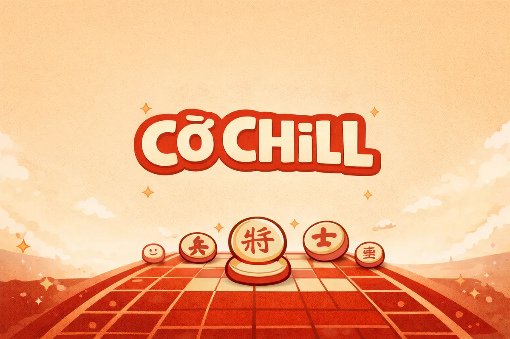

<div align="center">

# Cờ Chill | Xiangqi Learning

### Learn Xiangqi by thinking through the position—not by skipping to the answer.

**A Vietnamese-first Xiangqi learning app built around reflection, rule-grounded play, and deliberate practice.**

[Project website](https://cochill.vn) · [Run locally](#run-locally) · [Try a learning session](#try-a-learning-session)

[](https://github.com/thanhtq2701-alt/xiangqi07/actions/workflows/checks.yml)

<br>



</div>

## What is Cờ Chill?

Cờ Chill is a web application for learning and playing Xiangqi (Chinese chess). Its central design choice is simple: invite learners to reflect on a position before revealing an explanation, then give them a chance to retry and revisit related practice.

This repository contains the current V6 application source. It brings together a browser interface, a Python server, Xiangqi rules, learning flows, account-backed progress, and friendly online rooms. It is an evolving software project—not a claim of proven educational outcomes or a trained AI coach.

## The learning loop

1. **Study a position** and write down what you are considering.
2. **Choose and play a move**, with legal play checked against Xiangqi rules.
3. **Finish the exercise** before seeing its explanation.
4. **Review the explanation**, retry the line, and explore related practice.
5. **Return later** using the practice and review features.

The sequence is intentional: explanations should support a learner's own reasoning, not replace it. The app does not provide coaching during a live game.

## Product and engineering highlights

| Area | What is in the source |
|---|---|
| Learning experience | Reflection-first, multi-step exercises; retry; related practice; saved drafts and review scheduling |
| Rules and game integrity | Python and JavaScript Xiangqi rules; server-managed moves, clocks, and results for online friendly rooms |
| Accounts and persistence | Account sessions and synchronized learner state, with local guest play |
| Engine boundary | A basic heuristic bot and an optional Pikafish UCI adapter when an operator supplies a compatible engine |
| Explanations | Templates grounded in checked rules and exercise lines—not free-form engine claims |
| Frontend and server | Vanilla JavaScript and a Python WSGI server using SQLite |

The exercise catalog is intentionally described accurately: it currently includes 12 basic exercises, 8 tutorials, and 2 multi-step exercises. The two multi-step exercises share a tactical theme; they are not evidence of broad curriculum coverage.

## Engineering principles

- **Rules own chess truth.** Rules and configured engine evidence—not an explanation provider—determine legal moves and analysis.
- **Reflection comes first.** Keep solutions behind the learner's reflection and exercise flow.
- **Be precise about AI.** The basic bot uses heuristic search; explanations use templates. The project does not claim trained machine learning, human-level play, or measured learning impact.
- **Respect learner data.** The application does not send learner data to an AI service or use it to train a model. Local export and deletion features are available; see the [privacy notes](PRIVACY.md) for details and caveats.
- **Keep limitations visible.** Passing source checks does not certify a production deployment, a real Pikafish installation, security, or educational effectiveness.

## Try a learning session

1. Start the app using the instructions below and open it in your browser.
2. Choose guest mode, open the learning path, and select a multi-step exercise.
3. Complete the reflection prompts, try moves, and finish the line.
4. Read the explanation, retry, then look at related practice and the review schedule.

For a local friendly game, open a second browser window on the same machine. This demonstrates local behavior; it does not verify Internet multiplayer or a production engine. More demo context is in the [V6 handoff](docs/CLAUDE_HANDOFF_V6.md).

## Run locally

Python 3.12 is the tested version. From the repository root:

```powershell
python co_chill_server.py serve --port 8769
```

Open <http://127.0.0.1:8769/>. On Windows, you can also run [`Mo_Co_Chill_V6.cmd`](Mo_Co_Chill_V6.cmd). Keep the terminal open while using the app; press Ctrl+C to stop the server.

The server creates its SQLite data under `var/` by default. Keep databases, backups, logs, and account details out of Git. This command starts a local server; it does not deploy the application to the Internet. Node.js is needed for the JavaScript checks, not to run the app; use the version in [`.nvmrc`](.nvmrc).

## Run checks

From the repository root:

```powershell
python tools/run_checks.py
```

The check runner covers Python and JavaScript checks, exercise fixtures, and cross-language rules parity. On Windows, if your default Node.js does not match [`.nvmrc`](.nvmrc), pass the correct executable:

```powershell
python tools/run_checks.py --node "C:\Program Files\nodejs\node.exe"
```

GitHub Actions runs the repository check runner for pull requests and pushes to `codex-full`. Tests exercise the source; they do not prove that the configured production engine or infrastructure works. See [known limitations](KNOWN_LIMITATIONS.md).

## Repository map

| Path | Purpose |
|---|---|
| [`co_chill_server.py`](co_chill_server.py) | Application entry point, HTTP API, and static frontend serving |
| [`app/`](app/) | Server-side rules, accounts, persistence, online rooms, and engine adapters |
| [`online-preview/`](online-preview/) | Browser interface, rules, and learning flows |
| [`tests/`](tests/) and [`tools/`](tools/) | Tests, validation tools, and the check runner |
| [`docs/`](docs/) | Product decisions, handoff notes, and supporting documentation |
| [`deploy/`](deploy/) | Deployment and operations guidance |
| [`legacy/`](legacy/) | Older local-only application; not the current entry point |

The original V0.1 planning materials in [`docs/spec/`](docs/spec/) are preserved as historical source documents; [`docs/V6_DECISIONS.md`](docs/V6_DECISIONS.md) and [`KNOWN_LIMITATIONS.md`](KNOWN_LIMITATIONS.md) describe the current implementation and its caveats.

## Current limitations

- The learning catalog is small, and the two multi-step exercises cover the same tactical family.
- The basic bot is heuristic, not Pikafish; Pikafish and its network files are not included in this repository.
- English coverage is incomplete, and several planned learning and community features are not finished.
- The source pack does not independently verify the production VM, engine, load capacity, backups, or deployment configuration.
- The tests are not a security audit, a tournament-rules certification, or evidence that the product improves learning outcomes.

For the full, maintained list—including data and operations caveats—see [`KNOWN_LIMITATIONS.md`](KNOWN_LIMITATIONS.md). For privacy behavior, see [`PRIVACY.md`](PRIVACY.md).

## Contributing and deployment

Create a feature branch from `codex-full`, make a focused change, run the checks, and open a pull request. GitHub Actions runs the repository checks; do not push directly to `codex-full`. The project owner reviews changes and handles production deployment.

Read [`CONTRIBUTING.md`](CONTRIBUTING.md) for the contribution workflow and [`deploy/DEPLOY_GCP_VI.md`](deploy/DEPLOY_GCP_VI.md) for deployment guidance. A deployment guide is not evidence that the current source pack has independently verified the live infrastructure.

## Third-party software and project license

See [`THIRD_PARTY_NOTICES.md`](THIRD_PARTY_NOTICES.md) for third-party notices and engine-related information. This repository does not contain a `LICENSE` file, and the project owner has not selected a project license. Do not assume that the code, content, or artwork is available for reuse or redistribution.

## Tiếng Việt

Cờ Chill là ứng dụng web học và chơi cờ tướng, ưu tiên tiếng Việt. Điểm cốt lõi là người học tự suy nghĩ trước khi xem giải thích, sau đó có thể thử lại, học bài liên quan và quay lại ôn tập. Luật cờ quyết định nước đi hợp lệ; bot cơ bản dùng tìm kiếm heuristic và phần giải thích dùng mẫu, không phải AI đã được huấn luyện. Kho bài và nhiều chức năng vẫn còn giới hạn.

Chạy ứng dụng local bằng Python 3.12:

```powershell
python co_chill_server.py serve --port 8769
```

Xem [giới hạn hiện tại](KNOWN_LIMITATIONS.md), [quyền riêng tư](PRIVACY.md), [quyết định V6](docs/V6_DECISIONS.md) và [quy trình đóng góp](CONTRIBUTING.md). Việc chạy local hoặc bộ kiểm tra đạt không xác nhận hạ tầng production hay hiệu quả học tập.
