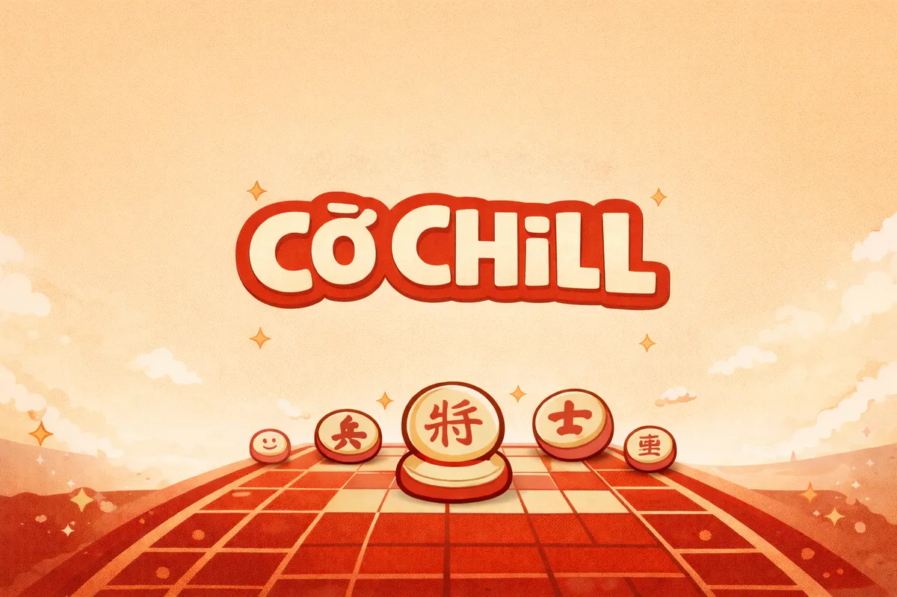
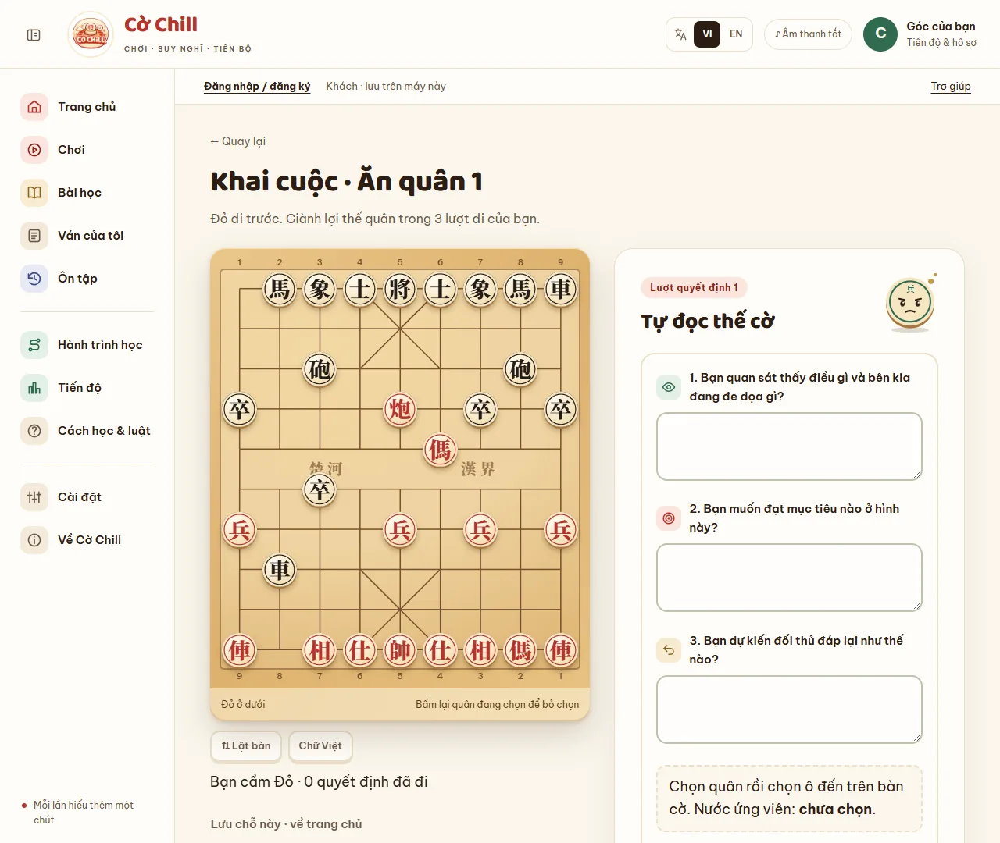
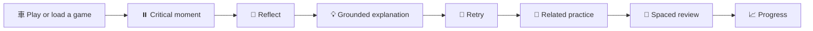
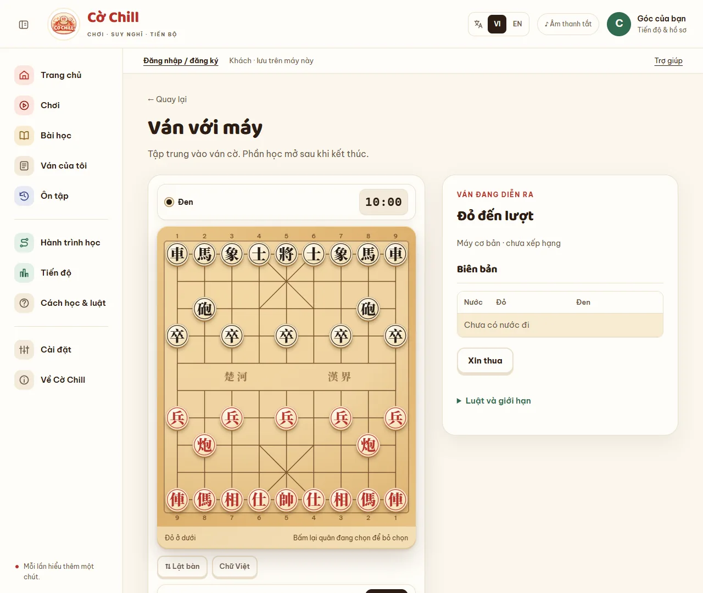
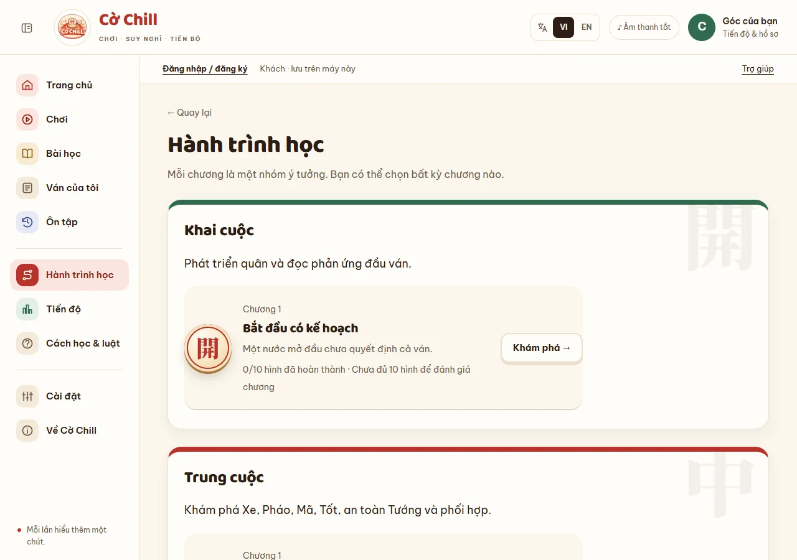
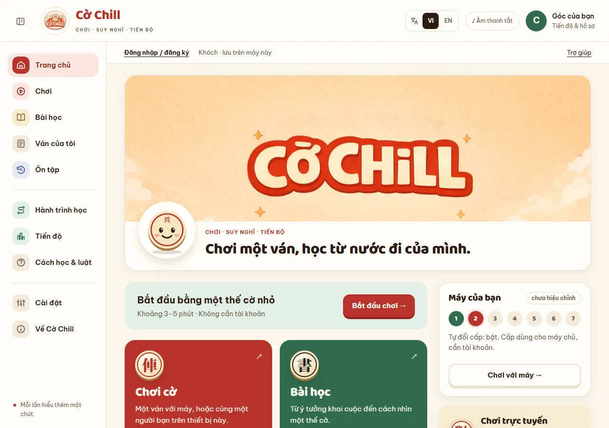
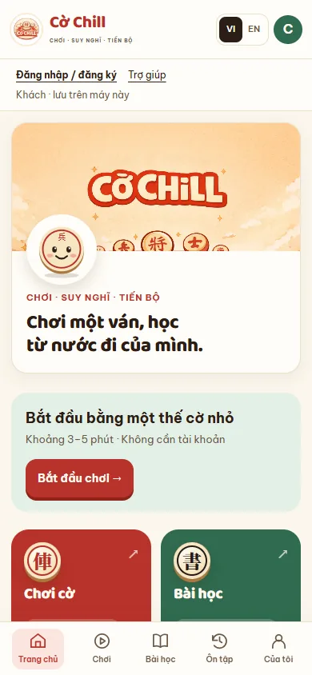

# 帥 Cờ Chill

### Learn Xiangqi by thinking through the position, not by skipping to the answer.

*Chơi một ván, học từ nước đi của mình.*

### [🏮 Play now at cochill.vn](https://cochill.vn)

 

  
   
  <b>Think first.</b> Every exercise asks what you see, what you want and how your opponent will reply, before any explanation appears.

## 🧧 Why Cờ Chill

Most puzzle apps tell you right or wrong and move on. Cờ Chill slows down at the moment that matters: you read the position, write down your plan, try your move, and only then see an explanation grounded in checked lines. Then you retry, practise a related position and come back for review a few days later.

## 🐉 Features

<table>
<tr>
<td width="50%" valign="top">

### 車 Play
Signed-in players face a **7-level bot** that moves up or down based on their last 10 games at a level; guests play a light bot on their own device. Or play two players on one device, or in friendly online rooms where the server owns moves, clocks and results.

</td>
<td width="50%" valign="top">

### 炮 Learn by chapter
Opening, middlegame and endgame chapters for the Rook, Cannon, Horse, Pawn, King safety and coordination, with multi-move exercises from a single decision up to five to seven.

</td>
</tr>
<tr>
<td valign="top">

### 兵 Reflection before answers
No solution is shown before you have thought it through, and no coaching appears during a live game.

</td>
<td valign="top">

### 馬 Spaced review
Positions you finish come back at growing intervals (1 / 2 / 7 / 14 / 30 days), and the ones you needed help with return sooner.

</td>
</tr>
<tr>
<td valign="top">

### 帥 Rules own the truth
Python and JavaScript rules are cross-checked on every change. Explanations are built only from checked lines, never invented moves or evaluations.

</td>
<td valign="top">

### 士 Your data, your call
Play as a guest with no account, or sign in to sync. Export, import with preview, and delete your own data at any time.

</td>
</tr>
</table>

## 📸 Screenshots

<table>
<tr>
<td width="50%"></td>
<td width="50%"></td>
</tr>
<tr>
<td align="center"><b>Play</b>: focus on the game; learning opens after it ends.</td>
<td align="center"><b>Learning journey</b>: pick any chapter, in any order.</td>
</tr>
<tr>
<td width="50%"></td>
<td width="50%" align="center"></td>
</tr>
<tr>
<td align="center"><b>Home</b>: one tap to start, no account needed.</td>
<td align="center"><b>Phone</b>: the same app with a bottom tab bar.</td>
</tr>
</table>

## 📚 What's inside

| 🧩 **12** | 📖 **9** | 🎯 **72** | 🤖 **7** | 🌐 **2** |
|:---:|:---:|:---:|:---:|:---:|
| basic exercises | lessons | multi-move exercises | bot levels | languages |

70 of the multi-move exercises were written and reviewed by the project owner. The app checks their rules, checkmates and material, not their quality.

## 🔍 Honest by design

- The bot levels are not calibrated against real players and carry no Elo. The server bot uses [Pikafish](https://github.com/official-pikafish/Pikafish), a separate open-source engine that is not included in this repository.
- Explanations are templates or written by the project owner. There is no trained AI coach.
- The review schedule and progress signals are simple, experimental rules. No measured learning impact is claimed.

## 📜 License

No license has been chosen yet, so the code, content and artwork are not licensed for reuse.

 

**[cochill.vn](https://cochill.vn)** · Vietnamese-first, with a full English mode · *Mỗi lần hiểu thêm một chút.*

